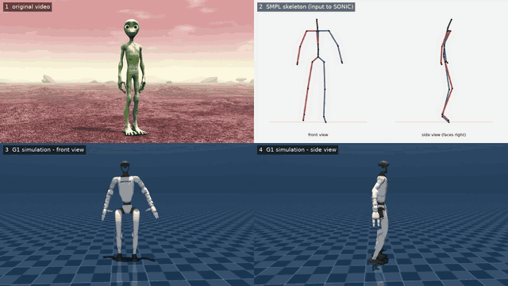

# YT-to-humanoid



*Top left to bottom right: the input video, the SMPL skeleton estimated from it, and the simulated G1 from the front and from the side. 40 s, one continuous shot. The dancer is a CGI character.*

A side project to run NVIDIA's open humanoid stack end to end: an ordinary video goes in, and a simulated Unitree G1 moves like the dancer in it.

```
video -> GEM-X (pose from video) -> SOMA to SMPL joints -> ZMQ -> SONIC (whole-body controller) -> G1 in MuJoCo
```

GEM-X and SONIC are NVIDIA's models. I did not train or change them. This repo is the glue around them, plus the tools I used to check how well the robot actually follows the input.

## What's here

- **Replay.** Converts the pose estimate to the stream SONIC expects and publishes it on a fixed schedule. NVIDIA's offline script ran a 24 fps clip at 14 fps on my machine, because conversion time added to every frame. Precomputing the frames fixes that.
- **Sim stack.** SONIC's MuJoCo sim on a virtual display with a browser view, started and driven from scripts, including the key press that releases the sim's elastic band.
- **Measurement.** Records the input stream and the robot's joint state on one clock, then compares limb angles, estimates latency and breaks down torso tracking.
- **Videos.** The four panels above. The two simulation views are re-rendered in MuJoCo from the logged robot state, so front and side show the identical motion.
- A 5-line patch for NVIDIA's SOMA-to-SMPL converter, and a test for it.


## Results

A few runs, not a benchmark.

- No falls in any replay (7 runs, 3 clips).
- On the clip above, human and robot limb angles correlate at 0.8 to 0.9 for arms and legs and 0.6 for torso lean. Mean error is 11.5 degrees.
- The robot's arms sit roughly 15 to 25 degrees higher than the person's, and it stands more upright (hips 10 to 17 degrees less flexed). These offsets appeared on every clip.
- Latency from input to robot is about 0.4 s. The simulation videos are shifted by that amount so they line up with the original.
- A side-on camera hurts. From the side, GEM-X cannot tell how far apart the hands are: clasped hands came out 0.6 m apart. The frontal clips looked much more plausible.


## Caveats

- One video per result, simulation only, SONIC used as released (no tuning).
- The demo subject is a CGI alien. GEM-X's human detector and keypoints still locked on, but this is not a test on real people.
- I ran SOMA-X v0.3.3, which is newer than the commit GEM-X pins. The converter patch is needed because of that, and I have not tested the pinned version.
- GEM-X ran on CPU on a shared machine, about a minute per second of video.


## Run it

Needs Linux, an NVIDIA GPU and TensorRT 10.13. Full steps are in [docs/SETUP.md](docs/SETUP.md). What I did and found, in more detail, is in [docs/REPORT.md](docs/REPORT.md).

```bash
git clone git@github.com:raoulbouri/YT-to-humanoid.git && cd YT-to-humanoid
cp config.example.env config.env      # set SONIC_WORK
bash setup/clone_and_patch.sh         # NVIDIA repos at the commits used here, plus the patch
# environments, models, deploy build: see docs/SETUP.md
bash pipeline/gemx/run_gemx.sh <clip>                         # video to pose (slow, CPU)
bash pipeline/sim/start_stack.sh && bash pipeline/sim/release_band.sh
bash pipeline/run_demo.sh <clip> <seconds> 30                 # replay, capture, latency, videos
```


## Layout

```
pipeline/   data, gemx, sim, replay, video, and run_demo.sh
analysis/   limb angles, latency, torso breakdown, plots
tests/      converter checks
setup/      clone NVIDIA's repos at pinned commits and patch
patches/    the converter patch
docs/       SETUP.md, REPORT.md
```


## Credits

GEM-X, SONIC and SOMA-X are NVIDIA's; licences are in [NOTICE.md](NOTICE.md). 